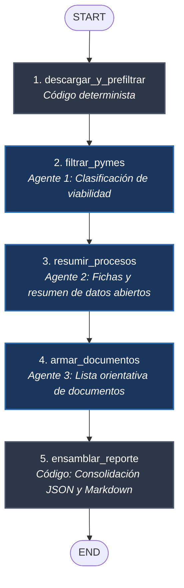

# Rastreador de Oportunidades en SECOP II para Pymes

Sistema multi-agente basado en **LangGraph** y **LangChain** para la vigilancia, triaje y estructuración diaria de oportunidades de contratación pública en Colombia a partir de datos abiertos de SECOP II ([datos.gov.co](https://www.datos.gov.co/)).

---

## 1. El Problema y Motivación

En jornadas hábiles típicas en Colombia, las entidades estatales de orden nacional y territorial publican cientos de procesos de contratación en SECOP II (por ejemplo, **423 procesos competitivos** registrados en la jornada auditada del 15 de octubre de 2026 en [`data/pruebas-reto/ejecuciones/20261020-223545_89fd/reporte.json`](data/pruebas-reto/ejecuciones/20261020-223545_89fd/reporte.json)). Para una micro, pequeña o mediana empresa (pyme):
- **Sobrecarga de revisión**: Es humanamente inviable revisar manualmente cientos de convocatorias antes de sus fechas de cierre.
- **Riesgo operativo**: Las pymes enfrentan asimetría de información frente a plazos breves y requisitos documentales exigidos.
- **Barreras técnicas**: El portal transaccional oficial de SECOP II (`community.secop.gov.co`) cuenta con barreras de automatización (Google ReCaptcha), lo que impide la lectura directa y masiva de pliegos oficiales.

Este sistema aborda el problema consumiendo exclusivamente las APIs públicas de datos abiertos de Socrata (`p6dx-8zbt` y `dmgg-8hin`), aplicando pre-filtros deterministas y orquestando agentes de lenguaje para identificar y estructurar oportunamente los procesos viables.

> 📋 *Auditoría de afirmaciones factuales*: Consulte [`docs/AUDITORIA-README.md`](docs/AUDITORIA-README.md) para el inventario de afirmaciones del repositorio contrastadas contra evidencias empíricas.

---

## 2. Qué Hace el Sistema Hoy

El sistema ejecuta una canalización diaria automatizada de 5 etapas:

1. **Descarga exclusiva de HOY**: Consulta en la API Socrata (`p6dx-8zbt`) únicamente los procesos publicados en la fecha corriente en hora legal de Colombia (UTC-5).
2. **Pre-filtro determinista por código**: Descarta sin costo de LLM procesos no competitivos (contratación directa, régimen especial), procesos cerrados, tipos de contrato excluidos (seguros, concesiones), cuantías superiores a $5.000M COP, ofertas vencidas y registros duplicados.
3. **Triaje y Clasificación (Agente 1)**: Evalúa los candidatos viables en páginas de 25 mediante la herramienta `filtro_basico` y clasifica cada proceso como `SÍ`, `NO` o `DUDOSO` para pymes, sustentando la decisión con señales objetivas.
4. **Ficha Técnica y Resumen Abierto (Agente 2)**: Consulta metadatos enriquecidos oficiales y genera un resumen del objeto contractual, alertas operativas y los puntos indispensables que la pyme debe confirmar en el pliego oficial.
5. **Estructuración de Documentos Habilitantes (Agente 3)**: Cruza la modalidad y tipo contractual con un catálogo auditado de 12 documentos de contratación estatal, deduplica contra nombres de anexos indexados en SECOP II (`dmgg-8hin`) y emite una lista orientativa. Si un proceso no tiene anexos indexados, resuelve la lista 100% en código ($0 USD, 0 tokens).
6. **Consolidación de Reporte Diario**: Genera automáticamente entregas estructuradas en `data/entregas/<fecha>/` y reportes en Markdown y JSON en `data/reportes/`.

---

## 3. Arquitectura del Grafo (LangGraph)

El flujo está modelado como un `StateGraph` de 5 nodos con estado tipado mediante esquemas Zod y canales con *reducers* para acumulación de listas y aislamiento de fallos:



---

## 4. Agentes y Herramientas

| Componente | Rol / Tipo | Descripción |
|---|---|---|
| `filtro_basico` | **Herramienta** | Expone los candidatos pre-filtrados al Agente 1 en páginas ordenadas de 25 registros. Memoiza la consulta en memoria para evitar llamadas redundantes a la API. |
| `agente_filtrador` | **Agente 1** | Modelo Grok (`grok-4.6`) con salida estructurada `ResultadoPagina`. Identifica viabilidad para pymes evaluando objeto, presupuesto, modalidad y ubicación. |
| `obtener_ficha_proceso` | **Herramienta** | Construye la ficha técnica con campos nativos de SECOP II, calcula los días restantes para presentar ofertas y consulta archivos anexos indexados en `dmgg-8hin`. |
| `agente_resumidor` | **Agente 2** | Modelo Grok con salida estructurada `ResumenProceso`. Genera el resumen del objeto, alertas para pymes y puntos a verificar. **Analiza metadatos abiertos, no lee pliegos**. |
| `armar_lista_documentos` | **Herramienta** | Consulta el catálogo general de 12 documentos habilitantes auditados según modalidad y tipo de contrato. |
| `agente_documentos` | **Agente 3** | Modelo Grok con salida estructurada `NotasDocumentos`. Emite notas sobre anexos indexados. Si el proceso no tiene anexos, el sistema resuelve la lista 100% en código sin invocar al modelo (0 tokens). |

---

## 5. Evaluación Científica y Benchmarks (Hito S3)

Para evaluar el sistema con rigor científico y sin alucinación de métricas, se construyó un benchmark empírico propio con datos reales de contratación pública colombiana.

### 5.1 Conjunto de Evaluación y Procedimiento de Etiquetado
- **Tamaño de la muestra**: **55 casos reales** de contratación pública en Colombia ([`data/pruebas-reto/evaluacion/casos-sin-etiquetar.json`](data/pruebas-reto/evaluacion/casos-sin-etiquetar.json) y [`claves-privadas.json`](data/pruebas-reto/evaluacion/claves-privadas.json)).
- **Estratificación**:
  - **Bloque A (40 casos viables)**: Candidatos que superaron el pre-filtro de código (25 `"si"`, 11 `"no"`, 4 `"dudoso"`).
  - **Bloque B (15 casos descartados por código)**: Muestra de control para auditar falsos descartes del pre-filtro determinista (11 `"si"`, 4 `"no"`).
- **Procedimiento humano**: Etiquetado ciego manual realizado exclusivamente por el autor del proyecto siguiendo los criterios objetivos de [`docs/GUIA-ETIQUETADO.md`](docs/GUIA-ETIQUETADO.md), con anonimización de IDs y ocultamiento de reglas de descarte durante la asignación de verdad de terreno (*Ground Truth*).

### 5.2 Rendimiento de Línea Base del Agente 1 ("filtrador")
Evaluado sobre el Bloque A (40 casos) mediante inyección de dependencias en [`src/tools/evaluar.ts`](src/tools/evaluar.ts) (corrida [`20261024-193537_55e6`](data/pruebas-reto/ejecuciones/20261024-193537_55e6/)):

| Métrica de Evaluación | Valor Obtenido | Detalle / Respaldo |
|---|:---:|---|
| **Exactitud (Accuracy)** | **85.0%** | 34 aciertos sobre 40 casos ([`resumen.md`](data/pruebas-reto/evaluacion/resultados/linea-base/resumen.md)) |
| **Precisión (Precision)** | **80.6%** | 25 clasificaciones "si" correctas sobre 31 "si" predichos |
| **Cobertura / Sensibilidad (Recall)** | **100.0%** | **25 de 25 oportunidades reales detectadas** (0 falsos negativos) |
| **Falsos Negativos (Oportunidades perdidas)** | **0** | Ningún proceso viable para pyme fue descartado por el modelo |
| **Falsos Positivos Graves** | **3 (7.5%)** | 3 casos "no aptos" que el modelo clasificó como "aptos" |
| **Matriz de Confusión Completa** | Ver CSV | [`data/pruebas-reto/evaluacion/resultados/linea-base/matriz.csv`](data/pruebas-reto/evaluacion/resultados/linea-base/matriz.csv) |

### 5.3 Tasa de Falso Descarte del Pre-filtro (Bloque B)
En la auditoría del Bloque B, **11 de los 15 casos descartados por código fueron catalogados como viables por el evaluador humano** (73.3% de divergencia de criterio). Las causas principales fueron:
- Descarte por fecha de recepción de ofertas vencida al momento de consulta nocturna, aunque estuviera vigente al momento de publicación.
- Procesos con presupuesto superior a $5.000M COP que una pyme podría ofertar mediante consorcios o uniones temporales.
*Conclusión*: El pre-filtro determinista actual es deliberadamente conservador para evitar saturar de procesos a la pyme.

### 5.4 Chequeo Automático de Invariantes (Agentes 2 y 3)
Dado que no existe *Ground Truth* para resúmenes de texto o listas de documentos (el pliego oficial nunca es leído), se evaluó el cumplimiento de **invariantes lógicas inmutables** sobre una muestra determinista de 10 casos reales ([`data/pruebas-reto/evaluacion/resultados/20261025-015244-agentes/resumen.md`](data/pruebas-reto/evaluacion/resultados/20261025-015244-agentes/resumen.md)):

| Invariante Evaluado | Agente | Tasa de Aprobación | Evidencia / Hallazgo |
|---|:---:|:---:|---|
| **Ficha vs Dataset oficial** | Agente 2 | **100.0%** (10/10) | Identidad exacta en valor, plazos, duración, lotes y entidad |
| **Cifras de 6+ dígitos respaldadas** | Agente 2 | **100.0%** (10/10) | Cero números o valores monetarios inventados en el texto |
| **Claves de `basadoEn` reales** | Agente 2 | **100.0%** (10/10) | Toda alerta cita un campo existente en `FichaProceso` |
| **Verificaciones en pliego no vacías** | Agente 2 | **100.0%** (10/10) | Todo proceso orienta a la pyme sobre qué revisar en el pliego |
| **No afirma haber leído el pliego** | Agente 2 | **100.0%** (10/10) | Nunca declara lectura de pliegos ni asume requisitos como hechos |
| **Requisitos habilitantes como hecho** | Agente 2 | **Revisión humana** | 1 caso señalado con mención prudencial de `capital_de_trabajo` |
| **Origen de ítems documentales** | Agente 3 | **100.0%** (10/10) | Todos provienen del catálogo auditado o de anexos reales |
| **Aviso fijo orientativo presente** | Agente 3 | **100.0%** (10/10) | Presencia de `"Lista orientativa: confirme siempre en el pliego oficial"` |
| **Respaldo legal no nulo** | Agente 3 | **100.0%** (10/10) | Jamás imprime `null` en fundamentos jurídicos |
| **Frase exacta sin anexos** | Agente 3 | **100.0%** (10/10) | Dice *"sin anexos indexados aún"* y jamás niega existencia |
| **Nada obligatorio sin negación** | Agente 3 | **90.0%** (9/10) | 1 caso con observación descriptiva usando "requerido" sin negación |
| **Sin duplicados documentales** | Agente 3 | **10.0%** (1/10) ❌ | **Fallo detectado**: En `dmgg-8hin`, las entidades suben múltiples archivos con nombres idénticos y el código no los deduplica |
| **Prueba forzando LLM (`--siempre-agente`)** | Agente 3 | **100.0%** en origen y negaciones; **0%** en duplicados | Mismo comportamiento de duplicación heredado de los datos de SECOP II |

### 5.5 Límites Honestos del Benchmark
1. **Tamaño muestral**: 55 casos constituyen una muestra acotada frente al volumen anual de SECOP II.
2. **Estratificación**: Al contener 25% de casos descartados para auditar el pre-filtro, el conjunto no refleja la prevalencia natural diaria de procesos viables.
3. **Anotador único**: Todas las etiquetas fueron asignadas por un único evaluador humano, lo que introduce un sesgo de criterio individual.

---

## 6. Contabilidad de Costos Financieros (USD)

Los costos se calculan a partir de la contabilidad estricta de tokens en `logs/tokens.jsonl` y se liquidan según las tarifas oficiales calibradas en [`config/precios.json`](config/precios.json) ($2.00 / 1M tokens de entrada, $6.00 / 1M tokens de salida).

> 📘 *Metodología de calibración*: Consulte [`docs/PRECIOS.md`](docs/PRECIOS.md) para el detalle del cálculo empírico de tokens de razonamiento (*reasoning tokens*) de Grok.

### Costo Unitario Medido por Tarea

| Tarea / Componente | Tokens Promedio por Unidad | Costo USD por Unidad | Notas / Modo de Ahorro |
|---|:---:|:---:|---|
| **Agente 1 (Triaje y clasificación)** | ~779 tokens facturados / candidato | **~$0.0013 USD** / candidato | Evaluado en páginas de 25 candidatos ($0.033 USD / página) |
| **Agente 2 (Ficha y resumen)** | ~7.561 tokens facturados / proceso | **~$0.0142 USD** / proceso | Incluye consulta de ficha y resumen honesto |
| **Agente 3 (Documentos — sin anexos)** | 0 tokens (código determinista) | **$0.0000 USD** / proceso | **Ahorro del 100%** resolviendo por catálogo en código |
| **Agente 3 (Documentos — con anexos / LLM)** | ~9.914 tokens facturados / proceso | **~$0.0169 USD** / proceso | Invocado solo cuando hay anexos indexados en SECOP II |
| **Oportunidad Completa Estructurada** | ~18.254 tokens facturados | **~$0.0324 USD** / proceso | Agente 1 (triaje) + Agente 2 (resumen) + Agente 3 (documentos) |

---

## 7. Historial de Ejecuciones (Libro Mayor)

El sistema mantiene un libro mayor inmutable y committeable en [`data/pruebas-reto/ejecuciones/registro.jsonl`](data/pruebas-reto/ejecuciones/registro.jsonl) y su consolidado en [`data/pruebas-reto/ejecuciones/RESUMEN.md`](data/pruebas-reto/ejecuciones/RESUMEN.md).

### Últimas Ejecuciones Registradas

| ID Ejecución | Inicio (UTC) | Tipo | Modo | Candidatos | Aptos | Resúmenes | Documentos | Tokens Facturados | Costo USD | Estado |
|---|---|:---:|:---:|---:|---:|---:|---:|---:|:---:|:---:|
| [`20261024-205244_ae97`](data/pruebas-reto/evaluacion/resultados/20261025-015244-agentes/) | 2026-10-25 01:52:44 | evaluacion | evaluacion | 0 | 0 | 10 | 10 | 202.123 | $0.3640 | ✅ ok |
| [`20261024-203627_2c6e`](data/pruebas-reto/evaluacion/resultados/20261025-013627-agentes/) | 2026-10-25 01:36:27 | evaluacion | evaluacion | 0 | 0 | 10 | 10 | 208.019 | $0.3651 | ✅ ok |
| [`20261024-193537_55e6`](data/pruebas-reto/ejecuciones/20261024-193537_55e6/) | 2026-10-25 00:35:37 | evaluacion | evaluacion | 40 | 31 | 0 | 0 | 31.172 | $0.0527 | ✅ ok |
| [`20261020-223545_89fd`](data/pruebas-reto/ejecuciones/20261020-223545_89fd/) | 2026-10-21 03:35:45 | normal | prueba | 423 | 20 | 20 | 20 | 313.970 | $0.5781 | ✅ ok |
| [`20261020-172456_dec9`](data/pruebas-reto/ejecuciones/RESUMEN.md) | 2026-10-20 22:24:56 | normal | prueba | 423 | 23 | 5 | 5 | 90.371 | n/c | ✅ ok |
| [`20261020-171939_0baf`](data/pruebas-reto/ejecuciones/RESUMEN.md) | 2026-10-20 22:19:39 | normal | prueba | 423 | 0 | 0 | 0 | 0 | n/c | ✅ ok |

*Nota: "n/c" indica corridas previas a la calibración de precios en `config/precios.json`.*

---

## 8. Limitaciones Objetivas y Marco Operativo

1. **El pliego de condiciones oficial NUNCA es leído**:
   Las páginas transaccionales de SECOP II (`community.secop.gov.co`) están protegidas por Google ReCaptcha. El sistema **no realiza web scraping ni evade medidas anti-bot**. Todo el análisis se basa en metadatos oficiales de datos abiertos de Socrata.
2. **Jornadas en curso pueden estar incompletas**:
   Las entidades públicas publican y actualizan procesos a lo largo de todo el día hábil. Una ejecución durante la mañana captura únicamente la fracción de procesos publicados hasta ese instante.
3. **Desfase en la indexación de archivos anexos**:
   El dataset abierto de anexos (`dmgg-8hin`) presenta un desfase habitual de 24 a 48 horas frente a la fecha de publicación. Que un proceso no tenga anexos indexados no significa que el pliego oficial no los contenga.
4. **Carácter no vinculante del catálogo de documentos**:
   La lista de documentos habilitantes es una guía orientativa basada en 12 documentos tipo y **NO constituye asesoría jurídica ni garantiza la adjudicación**. Cada pliego oficial establece las exigencias vinculantes.
5. **Alcance de la evaluación empírica**:
   Las métricas de rendimiento corresponden al set de 55 casos evaluados; la variación en procesos de sectores no representados en la muestra puede diferir.

---

## 9. Ejecución del Sistema

### Requisitos previos
- Node.js 22+ y pnpm (`corepack enable`).
- Archivo `.env` con las credenciales necesarias (ver sección Variables de Entorno).

### 9.1 Ejecución Local

```powershell
# Ejecución diaria estándar (procesa candidatos y hasta 5 procesos aptos)
pnpm start

# Ejecución personalizada con banderas
pnpm start --max=50 --max-aptos=10 --incluir-dudosos

# Ejecución completa de toda la jornada (elimina topes)
pnpm start --completo

# Reanudar ejecución (omite etapas ya guardadas en data/entregas/<fecha>/ sin gastar créditos)
pnpm start --reanudar

# Modo prueba / histórico (emula ejecución en fecha pasada)
$env:SECOP_FECHA_PRUEBA="2026-10-15"; pnpm start

# Ejecutar evaluación del Agente 1 contra benchmark humano (S3-4)
pnpm evaluar

# Ejecutar chequeo de invariantes para Agentes 2 y 3 (S3-5)
pnpm evaluar:agentes

# Consolidar hoja de revisión humana de fidelidad (S3-5)
pnpm evaluar:hoja

# Reporte consolidado de consumo de tokens y promedios por proceso
pnpm costos

# Verificación estricta de TypeScript (0 errores)
pnpm typecheck
```

### 9.2 Ejecución con Docker

```powershell
# Construir la imagen
docker compose build

# Ejecutar el rastreador dentro del contenedor
docker compose run --rm agent

# Ejecutar con fecha histórica de prueba y reanudación
docker compose run --rm -e SECOP_FECHA_PRUEBA=2026-10-15 agent pnpm start --reanudar

# Consultar métricas de tokens dentro del contenedor
docker compose run --rm agent pnpm costos
```

---

## 10. Variables de Entorno

El archivo `.env` local debe definir las siguientes variables (los valores nunca deben committearse ni compartirse):

- `RETO_KEY`: Clave de acceso al gateway del modelo de lenguaje (Grok / xAI).
- `LANGSMITH_TRACING`: Bandera booleana (`true` o `false`) para activar la telemetría en LangSmith.
- `LANGSMITH_API_KEY`: API Key de LangSmith para telemetría.
- `LANGSMITH_PROJECT`: Nombre del proyecto en LangSmith (por defecto `secop-rastreador`).
- `SECOP_FECHA_PRUEBA`: *(Opcional)* Fecha en formato `YYYY-MM-DD` para simular la ejecución en una jornada histórica utilizando la caché local.

---

## 11. Trazabilidad en LangSmith

Cuando `LANGSMITH_TRACING=true` está configurado, cada ejecución del grafo se registra bajo el árbol jerárquico `secop-diario` con etiquetas `["secop", "diario"]` y metadatos completos (`fecha`, `modo`, `fechaReferencia`, `caps`).

1. **Raíz (`secop-diario`)**: Registra la duración global, estado y métricas acumuladas de la jornada.
2. **Nodos del Grafo**: Cada etapa aparece como un tramo anidado:
   - `descargar_y_prefiltrar`: Conteo de filas procesadas y desglose de exclusiones.
   - `filtrar_pymes`: Despliega las llamadas concurrentes `filtrador:pagina-N` y las consultas a `filtro_basico`.
   - `resumir_procesos`: Despliega las llamadas hijo `resumidor:<id_proceso>` con sus invocaciones a `obtener_ficha_proceso`.
   - `armar_documentos`: Despliega las llamadas `documentos:<id_proceso>` (solo para procesos con anexos) y consultas a `armar_lista_documentos`.
   - `ensamblar_reporte`: Generación final y almacenamiento de archivos.

---

## 12. Extracto Real de Reporte Generado

A continuación se presenta un extracto textual sin modificaciones obtenido de la ejecución sobre la fecha de prueba `2026-10-15` ([`data/pruebas-reto/ejecuciones/20261020-223545_89fd/reporte.md`](data/pruebas-reto/ejecuciones/20261020-223545_89fd/reporte.md)):

```markdown
### 1. [CO1.REQ.11205986] ADQUIRIR EL SERVICIO DE INFRAESTRUCTURA PARA DESPLIEGUE EN NUBE DE LA PLATAFORMA; PROCESAMIENTO Y ALMACENAMIENTO DE LA RADICACIÓN DE FACTURA ELECTRÓNICA; EN LA PRESTACIÓN DE SERVICIOS DE SALUD ENMARCA

- **Entidad Compradora**: DEPARTAMENTO DE SANTANDER
- **Ubicación**: Bucaramanga, Santander
- **Modalidad**: Mínima cuantía
- **Tipo de Contrato**: Prestación de servicios
- **Presupuesto Oficial**: $ 44.166.500
- **Plazo de Ofertas**: 2026-10-20T00:00:00.000 (⏳ 5 día(s))
- **Duración Estimada**: 0 día(s)
- **Estructura de Lotes**: Sin lotes (oferta global)
- **Enlace Oficial en SECOP II**: [Ver proceso en SECOP II](https://community.secop.gov.co/Public/Tendering/OpportunityDetail/Index?noticeUID=CO1.NTC.11070456)

#### Archivos Anexos Indexados en SECOP II
*Sin archivos anexos indexados aún en el dataset `dmgg-8hin` de SECOP II.*

#### Resumen del Objeto (Agente 2 — Datos Abiertos)
La entidad busca contratar un servicio de infraestructura en la nube para desplegar una plataforma y para procesar y almacenar la radicación de factura electrónica, en la prestación de servicios de salud. El objeto se enmarca en un proyecto de asistencia para atención en salud a población a cargo del departamento (extranjera e inimputable) en Santander.

#### Alertas Técnicas para la Pyme
- ⚠️ **Queda poco tiempo para presentar oferta; el calendario de presentación es apretado para armar una propuesta de servicios en nube.** *(Basado en campo: `diasRestantes`)*
- ⚠️ **En los datos abiertos la duración del contrato aparece en cero días: no se puede dar por hecho el plazo de ejecución y hay que confirmarlo en el pliego.** *(Basado en campo: `duracion`)*
- ⚠️ **El proceso no está dividido en lotes, así que se trata de un único paquete y no de adjudicaciones parciales.** *(Basado en campo: `lotes`)*
- ⚠️ **La modalidad es mínima cuantía (presupuesto por debajo del umbral de menor cuantía): conviene revisar en el pliego las reglas y el formulario de oferta propios de esa modalidad, sin asumir de antemano cómo se evalúa.** *(Basado en campo: `modalidad`)*
- ⚠️ **El tipo de contrato es prestación de servicios (no compraventa de bienes): hay que verificar alcance, obligaciones y forma de pago en el pliego.** *(Basado en campo: `tipoDeContrato`)*

#### Puntos Clave a Verificar en el Pliego Oficial
- 🔍 Requisitos habilitantes de experiencia específica (nube, plataformas, facturación electrónica o salud) y si piden contratos similares o certificaciones.
- 🔍 Capacidad financiera e indicadores (patrimonio, liquidez, endeudamiento u otros) y si hay umbrales mínimos.
- 🔍 Garantías de seriedad de la oferta, de cumplimiento y demás pólizas, montos y vigencias.
- 🔍 Criterios de evaluación, factores de desempate y si el precio es el único puntaje o hay factores técnicos.
- 🔍 Especificaciones técnicas de la nube (capacidad, disponibilidad, ubicación de datos, copias, soporte) y niveles de servicio.
- 🔍 Plazo real de ejecución, fecha de inicio, prórrogas y si hay cronograma de desplieque.
- 🔍 Anticipo, forma de pago, facturación y si hay retenciones o pagos contra entregables.
- 🔍 Visita técnica, audiencia o mesas de aclaraciones, y si son obligatorias.
- 🔍 Tratamiento de datos personales y de salud, confidencialidad y requisitos de seguridad de la información.
- 🔍 Anexos, formatos de oferta económica y documentos que hay que diligenciar y firmar.

#### Lista Orientativa de Documentos Habilitantes
> ℹ️ *Aviso obligatorio: Lista orientativa: confirme siempre en el pliego oficial.*

- 🏛️ `[Catálogo con Emisor]` **Registro Único Tributario (RUT)** *(ID: `rut`)*
  - **Fundamento / Emisor**: https://www.dian.gov.co/
  - **Condición**: Puede exigirse según el pliego; verificar.
  - **Expide**: Dirección de Impuestos y Aduanas Nacionales (DIAN)
  - **Observación**: Documento del catálogo general de referencia; confirme en el pliego oficial.
- 🏛️ `[Catálogo con Emisor]` **Certificado de existencia y representación legal o matrícula mercantil** *(ID: `existencia_representacion`)*
  - **Fundamento / Emisor**: https://www.rues.org.co/
  - **Condición**: Puede exigirse según el pliego; verificar.
  - **Expide**: Cámaras de Comercio (Registro Único Empresarial y Social - RUES)
  - **Observación**: Documento del catálogo general de referencia; confirme en el pliego oficial.
- 📋 `[Catálogo sin Emisor]` **Documento de identidad del representante legal o persona natural proponente** *(ID: `cedula_representante`)*
  - **Fundamento / Emisor**: Catálogo general (sin emisor oficial enlazado; confirme en pliego)
  - **Condición**: Puede exigirse según el pliego; verificar.
  - **Expide**: Registraduría Nacional del Estado Civil o autoridad migratoria
  - **Observación**: Documento del catálogo general de referencia; confirme en el pliego oficial.
```
